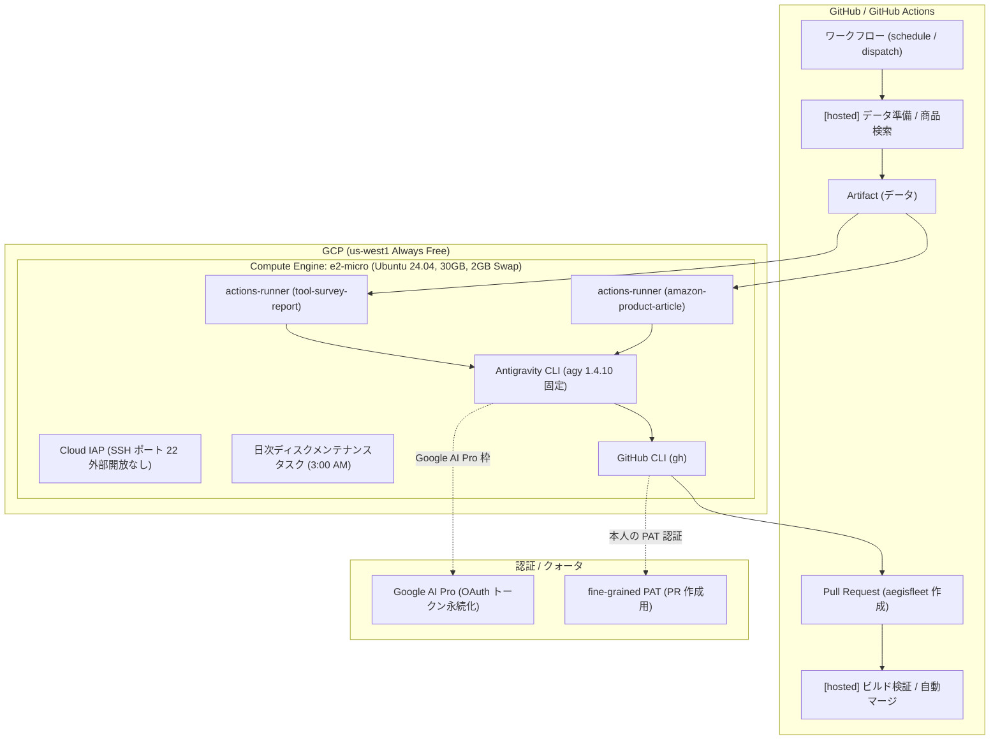

# Antigravity on GCP (e2-micro Self-Hosted Runner)

Google Cloud Platform（GCP）の **Always Free 枠（`e2-micro`）** を活用し、**Google Antigravity CLI (`agy`)** と **GitHub Actions セルフホステッドランナー** を安全かつ安定して自動構築・運用するための管理ツールキットです。

Jules サービス終了に伴い、`aegisfleet/tool-survey-report` および `aegisfleet/amazon-product-article` をはじめとするリポジトリの定期調査・レポート自動生成・自律 PR 作成ワークフローを、Google AI Pro サブスクリプション枠を用いて GCP 上で完全移行・定常運転することを目的としています。

---

## 🎯 アーキテクチャ概要



---

## 🚀 主な特徴

- 💰 **GCP Always Free 枠の完全活用**:
  - `e2-micro`（us-west1 / us-central1 / us-east1）、標準永続ディスク 30GB で月額基本コスト 0 円で運用。
  - RAM 1GB 環境でも安定動作するよう **2GB Swap** を自動構成し、`vm.swappiness=20` にチューニング。
- 🛡 **インバウンドポート全遮断 & Cloud IAP トンネル**:
  - ポート 22 番の外部インターネット開放は行わず、**Google Cloud Identity-Aware Proxy (Cloud IAP)** 経由でのみ安全にアクセス。ファイアウォールルールも自動検出・自動作成。
- ⚡ **CPU 命令セット ゲート検証（PCLMULQDQ チェック）**:
  - `agy` バイナリが SIGILL（不正命令例外）で異常終了する既報に対処。セットアップ冒頭で `/proc/cpuinfo` の `pclmulqdq` 命令有無を自動判定。
- 🧠 **Antigravity CLI (`agy`) 1.4.10 固定 & 実行環境の標準化**:
  - `AGY_CLI_DISABLE_AUTO_UPDATE=true` による意図しない自動更新の抑止。
  - ダミー `SSH_CONNECTION` を export し、OAuth ファイルトークンモードを確実に利用。
  - `settings.json` の permissions プリセット設定。
- 🏃 **マルチ runner サービス自動化**:
  - 専用ユーザー `runner` 配下にリポジトリごとの独立した runner サービス（`systemd`）を安全に登録・常駐化。
- 🧹 **30GB ディスク枯渇防止（自動メンテナンス cron）**:
  - `~runner/.gemini/antigravity/brain` 内の会話ログや一時ファイルを定期クリーンアップ（7日経過分を日次自動削除）。
- 🐍 **クロスプラットフォーム管理 CLI (`manager.py`)**:
  - 外部 Python パッケージへの依存ゼロ（標準ライブラリのみ）。Windows / macOS / Linux いずれのホストからでも対話メニューまたはサブコマンドで直感的に操作可能。

---

## 📋 前提条件

1. **Google Cloud SDK (`gcloud` CLI)**:
   - ホストマシンにインストールされ、ログイン・プロジェクト設定が完了していること。
     ```bash
     gcloud auth login
     gcloud config set project cloud-execution-environment
     ```
2. **GCP プロジェクト**:
   - Compute Engine API が有効化されていること。
3. **Google アカウント (Google AI Pro)**:
   - `agy login` 時にブラウザで認証を行うアカウント。
4. **対象 GitHub リポジトリの Runner 登録トークン**:
   - `Settings -> Actions -> Runners -> New self-hosted runner` から取得できる登録トークン（有効期限1時間）。

---

## 📁 ディレクトリ構成

```
antigravity-on-gcp/
├── .env.example              # 環境設定テンプレート
├── .gitignore                # Git 除外定義 (.env, 一時ファイル)
├── LICENSE                   # ライセンス
├── README.md                 # 本ドキュメント
├── manager.py                # ホスト側統合管理 CLI (Python 標準ライブラリ)
├── templates/
│   └── settings.json         # agy 設定ひな型 (permissions allow)
└── scripts/
    ├── host/                 # ホスト側ヘルパー
    │   ├── gcp_provision.py  # gcloud VM プロビジョニング / ファイアウォール
    │   └── gcp_ssh.py        # IAP トンネル SSH / SCP
    └── vm/                   # VM 内実行スクリプト群
        ├── 00-check-cpu.sh   # PCLMULQDQ 命令ゲート検証
        ├── 01-setup-os.sh    # Swap 2GB, OS 更新, 自動更新有効化
        ├── 02-setup-node-agy.sh # Node.js LTS, agy 1.4.10 固定インストール
        ├── 03-setup-gh.sh    # GitHub CLI (gh) インストール
        ├── 04-setup-runner.sh # actions-runner インストール & systemd 登録
        ├── 05-setup-maintenance.sh # ディスク容量監視・定期削除 cron
        ├── 06-setup-tailscale.sh # (オプション) Tailscale インストール
        └── run-all.sh        # VM 側ベーススクリプト一括実行
```

---

## ⚡ クイックスタート

### 1. 環境設定

`.env.example` をコピーして `.env` を作成し、必要に応じて設定を調整します。

```bash
cp .env.example .env
```

**.env 設定例**:
```ini
GCP_PROJECT_ID=cloud-execution-environment
GCP_REGION=us-west1
GCP_ZONE=us-west1-b
GCP_INSTANCE_NAME=agy-runner-vm
TARGET_REPOS=your-org/your-repo1,your-org/your-repo2
```

### 2. 管理コンソールの起動

引数なしで実行すると対話型メニューが起動します。

```bash
python manager.py
```

```
==================================================
    Antigravity on GCP Management Console        
==================================================
Project:  cloud-execution-environment
Instance: agy-runner-vm (us-west1-b)
--------------------------------------------------
1) Provision VM (e2-micro Always Free)
2) Run Full Setup (OS, Swap, Node, agy, Runners)
3) Authenticate agy (Interactive OAuth Login)
4) Connect via SSH (IAP Tunnel)
5) Check Status (VM & runner services)
6) Start VM
7) Stop VM
8) Delete VM
q) Exit
--------------------------------------------------
Select an option [1-8 / q]:
```

### 3. ステップバイステップ導入手順

#### Step 1: VM のプロビジョニング
メニュー `1`（または `python manager.py provision`）を選択。
- IAP 用ファイアウォールルール（`allow-ssh-ingress-from-iap`）を確認・作成。
- `e2-micro`、30GB 標準永続ディスク、Ubuntu 24.04 LTS の VM を作成。

#### Step 2: 全体セットアップ
メニュー `2`（または `python manager.py setup`）を選択。
1. スクリプト群を VM の `/tmp/vm-scripts` に転送。
2. **CPU ゲートチェック (00)**: `pclmulqdq` 命令の有無を確認。
3. **OS・Swap 構成 (01)**: 2GB Swap 作成、OS パッケージ更新。
4. **Node.js & agy 導入 (02)**: Node.js 22 LTS、agy 1.4.10 固定、runner 専用ユーザー作成。
5. **GitHub CLI 導入 (03)**: `gh` CLI のセットアップ。
6. **定期メンテ cron 導入 (05)**: ディスク容量枯渇防止のクリーンアップスクリプトを登録。
7. **GitHub Runner 登録 (04)**:
   - 設定された各対象リポジトリ（`tool-survey-report`, `amazon-product-article` 等）の登録トークンを画面上で対話入力。
   - `actions-runner` をダウンロード、設定、systemd サービスとして自動起動。

#### Step 3: Antigravity CLI 初回認証 (OAuth)
セットアップの最後、またはメニュー `3`（`python manager.py login-agy`）を実行。
1. VM 上で `su - runner -c 'agy login'` が対話実行される。
2. 画面に表示される Google 認証用 URL をブラウザで開き、認証コードを入力して承認。
3. `agy models` または `agy -p "Hello"` で疎通を確認。

#### Step 4: PR 作成用 PAT の設定（gh auth）
VM に SSH 接続（メニュー `4` または `python manager.py ssh`）し、runner ユーザーで本人の fine-grained PAT を設定します。

```bash
sudo -i -u runner
# PAT を使って GitHub CLI にログイン (Contents / Pull requests 権限が必要)
echo "<YOUR_FINE_GRAINED_PAT>" | gh auth login --with-token
gh auth status
```

> [!IMPORTANT]
> **なぜ GITHUB_TOKEN ではなく個人の PAT なのか？**
> `GITHUB_TOKEN` で作成した PR は、再帰防止仕様により `pull_request` トリガーの自動マージワークフロー（`pr-auto-merge` 等）を起動しません。Jules の代替として完全自動化を実現するために、VM 上の `gh` にのみ個人の fine-grained PAT を保持させます。

---

## 🛠 運用・保守ガイド

### 1. agy 実行時のベストプラクティス（ワークフロー内）
GitHub Actions のワークフロー内で agy を実行する際は、以下のパラメータを指定します。

```yaml
- name: Run Antigravity CLI
  run: |
    # ダミー SSH_CONNECTION を設定（ファイルトークン認証を保証）
    export SSH_CONNECTION="dummy 12345 127.0.0.1 22"
    export AGY_CLI_DISABLE_AUTO_UPDATE=true

    # stdin を閉じ、タイムアウト・トークン使用量出力を指定
    agy -p "${PROMPT_TEXT}" \
      --print-timeout 40m \
      --output-format json < /dev/null
```

### 2. PAT のローテーション（90日ごと）
1. GitHub で新しい fine-grained PAT を発行（Contents: R/W, Pull requests: R/W）。
2. `python manager.py ssh` で VM にログイン。
3. `sudo -i -u runner` に切り替え、`gh auth login --with-token` で更新。

### 3. VM の再起動耐性テスト
```bash
python manager.py status
# VM を再起動
python manager.py ssh
sudo reboot
# 数分後に状態確認 (runner サービスが自動復帰しているか確認)
python manager.py status
```

### 4. クォータと利用状況の確認
runner ユーザー上でモデルやクォータを確認できます。
```bash
sudo -i -u runner
agy models
```

---

## 📄 ライセンス

[MIT License](LICENSE)
